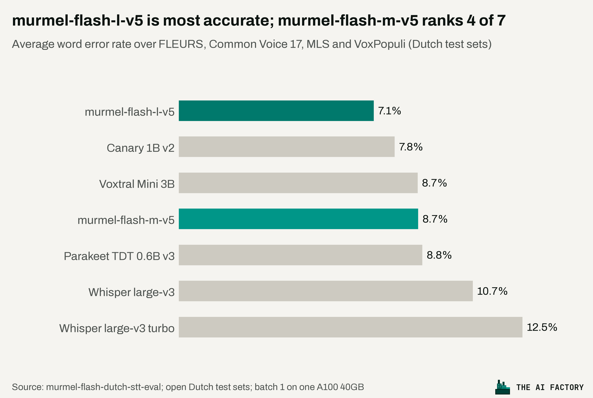

<p align="center">
  
</p>

<h1 align="center">murmel-flash-dutch-stt</h1>

<p align="center"><b>Dutch speech recognition, built in the Netherlands.</b><br>
Turn audio into text, with punctuation, timestamps and your own word lists, on your own machine.</p>

> **Model access:** the weights are gated on Hugging Face. Request access and accept the [murmel-flash licence](#licence) on
> the [model page](https://huggingface.co/theaifactorybv/murmel-flash-m-v5), then log in with `hf auth login`. See
> [Getting started](#getting-started).

<p align="center">
  <a href="https://huggingface.co/theaifactorybv/murmel-flash-m-v5">Model</a> ·
  <a href="https://murmel.nl/">murmel.nl</a> ·
  <a href="https://api.murmel.eu/v1/docs">API docs</a> ·
  <a href="LICENSE">Licence</a>
</p>

---

**murmel-flash** is The AI Factory's series of small, fast speech recognition models for Dutch, the family behind
[murmel.nl](https://murmel.nl/), the Dutch transcription service from Amsterdam. This repository contains the open
member of the series, `murmel-flash-m-v5`: a 128M-parameter model, trained from scratch for Dutch (with English as a
second language), that runs comfortably on a laptop CPU and even on-device on recent phones.

The larger murmel models are more accurate still. They power [murmel.nl](https://murmel.nl/) (web-based studio, free
two-week trial) and the hosted API at [api.murmel.eu](https://api.murmel.eu/v1/docs), and are available self-hosted
under a commercial licence.

## What you get

- **Accurate Dutch**: 8.7 % average WER on four open Dutch test sets, against 10.7 % for Whisper large-v3, at a twelfth
  of its size and five times its speed (see [Results](#results)).
- **No text on silence**: on speech-free audio (noise, hum, silence) it writes something on ~4 % of clips, against
  68 % for whisper-large-v3-turbo, which is known for inventing subtitle credits.
- **Readable text**: punctuation, casing, digits for numbers; the language (Dutch or English) is recognised per window and can switch mid-file.
- **Word-level timestamps**: every word with start and end time, ready for subtitles (SRT/VTT) or search.
- **Your own word lists**: names, places and jargon that must be spelled right, boosted at decode time, no retraining.
- **Any file, any length**: wav, flac, mp3, m4a, mp4, webm; hour-long recordings are windowed at pauses and joined back into sentences.
- **Live from the microphone**: `murmel-flash --mic` transcribes as you speak; the same streaming session works for calls and broadcasts.
- **Drop-in for other apps**: `murmel-flash serve` is an OpenAI-compatible endpoint for OpenWhispr and any client of the OpenAI audio API.
- **Fast and small**: ~19x realtime on a laptop CPU, 100-150x realtime on a single T4 GPU; a 512 MB download.

## Results

Benchmark on four commonly used open Dutch test sets, with every model on the same audio, one clip at a time on one
A100. The benchmark is fully reproducible:
[The-AI-Factory/murmel-flash-dutch-stt-eval](https://github.com/The-AI-Factory/murmel-flash-dutch-stt-eval).




| Model | Publisher | Params | FLEURS | Common Voice 17 | MLS | VoxPopuli | Average | Speed (RTFx) |
|---|---|---|---|---|---|---|---|---|
| murmel-flash-l-v5 ¹ | The AI Factory | 397M | 7.8 | **3.7** | **7.5** | **9.4** | **7.1** | 30 |
| Canary 1B v2 | NVIDIA | 978M | 6.0 | 4.4 | 9.8 | 11.2 | 7.9 | 16 |
| Voxtral Mini 3B | Mistral AI | 4.7B | 5.8 | 5.0 | 9.8 | 14.1 | 8.7 | 7 |
| **murmel-flash-m-v5** (this package) | The AI Factory | **128M** | 9.7 | 5.1 | 9.4 | 10.6 | 8.7 | 40 |
| Parakeet TDT 0.6B v3 | NVIDIA | 600M | 7.9 | 4.9 | 11.1 | 11.5 | 8.9 | 101 |
| whisper-large-v3 | OpenAI | 1.55B | **5.6** | 4.2 | 9.8 | 23.1 | 10.7 | 8 |
| whisper-large-v3-turbo | OpenAI | 809M | 6.0 | 5.8 | 9.6 | 28.4 | 12.5 | 37 |

¹ Not yet available as open weights.

### Models available as open weights

| Model | Publisher | Params | Download | Average WER (benchmark above) |
|---|---|---|---|---|
| **murmel-flash-m-v5** | The AI Factory | 128M | [theaifactorybv/murmel-flash-m-v5](https://huggingface.co/theaifactorybv/murmel-flash-m-v5) (512 MB) | 8.7 % |

## Getting started

**1. Install.** Python 3.10 to 3.13 (tested on 3.13; brand-new Python releases often have no PyTorch build yet),
from source:

```bash
git clone https://github.com/The-AI-Factory/murmel-flash-dutch-stt
cd murmel-flash-dutch-stt
python -m venv .venv && source .venv/bin/activate      # Windows: .venv\Scripts\activate
pip install -e .
```

For mp3, m4a, mp4 or webm input you also need `ffmpeg` on your PATH (`brew install ffmpeg` on macOS,
`sudo apt install ffmpeg` on Debian/Ubuntu, `winget install ffmpeg` on Windows). wav, flac, aiff and ogg work
without it, at any sample rate.

PyTorch is installed as a dependency; on Linux with an NVIDIA GPU, install the CUDA build first if you want GPU
speed (`pip install torch --index-url https://download.pytorch.org/whl/cu124`). CPU is fine otherwise.

**2. Get access to the model.** The weights are on the Hugging Face Hub behind a licence gate: you need a (free)
Hugging Face account and must accept the [murmel-flash licence](#licence) before you can download them.

1. Open [theaifactorybv/murmel-flash-m-v5](https://huggingface.co/theaifactorybv/murmel-flash-m-v5) while logged in,
   fill in the short form and click **Request access**.
2. Wait for approval. Requests are reviewed by hand; until then the download fails with a 401/403 error.
3. Log in on the machine that runs the model, so the download can authenticate:

   ```bash
   hf auth login                 # paste a token from https://huggingface.co/settings/tokens (read access is enough)
   # or: export HF_TOKEN=hf_...
   ```

After that there is nothing to download by hand: the first call to `from_pretrained` (or the first CLI run) fetches
the model into `~/.cache/huggingface` and reuses it afterwards. Download size: **512 MB** (`model.safetensors`,
fp32; the tokenizer and config add under 1 MB).

**3. Transcribe a file.**

```bash
murmel-flash interview.mp3                        # prints the transcript
murmel-flash interview.mp3 --json out/            # also writes out/interview.json (segments, words with times)
murmel-flash call.wav --words "Omtzigt,Hanzehogeschool,Bolsward"   # names that must be spelled right
murmel-flash lecture.mp3 --mode ctc               # ~3x faster, a little less accurate
murmel-flash --mic                                # live from the microphone (pip install sounddevice)
murmel-flash serve                                # OpenAI-compatible API on http://127.0.0.1:8765/v1
```

**4. Use it from Python.**

```python
from murmel_flash import Transcriber, load_audio

tr = Transcriber.from_pretrained()                # murmel-flash-m-v5; GPU if available, else CPU
wave = load_audio("interview.mp3")                # any format ffmpeg reads -> 16 kHz mono
res = tr.transcribe(wave)

print(res["text"])
for w in res["words"][:3]:
    print(w)          # {'word': 'Goedenavond,', 'start': 0.42, 'end': 0.91}
for seg in res["segments"]:
    print(f"[{seg['start']:6.1f}-{seg['end']:6.1f}] ({seg['language']}) {seg['text']}")
```

Load the model once and reuse it; `transcribe()` can be called from several threads. Pass `device="cpu"` or
`device="cuda"` to `from_pretrained` to override the automatic choice, or a repo id / local directory as the first
argument to load another murmel-flash model.

## Examples

**Word lists.** Pass the names and terms that matter for this recording; the beam search then prefers hypotheses that
spell them. Spell them as they should appear in the transcript.

```python
res = tr.transcribe(wave, hotwords=["Bab el-Mandeb", "Carolien Stolte", "BRICS"])
```

**Subtitles.** `res["segments"]` carries start, end and text per window and `res["words"]` the timed words: enough
to write SRT/VTT directly.

**Speed or quality.** Two knobs, in Python, on the command line and for live input:

| | Python | CLI | |
|---|---|---|---|
| best quality (default) | `mode="beam", beam=4` | `--mode beam --beam 4` | attention beam search |
| a bit faster | `beam=1` or `beam=2` | `--beam 1` | greedy / narrow beam, somewhat less accurate |
| fastest | `mode="ctc"` | `--mode ctc` | CTC head only: ~3x faster, ~2 WER points worse, no word lists |

`murmel-flash serve --beam N` sets the beam for the server.

**Microphone and live input.** `murmel-flash --mic` transcribes the microphone until Ctrl-C (`pip install sounddevice` once).
In Python, feed audio as it arrives from a microphone, a call or a broadcast. While a stretch of speech is
open you get a cheap partial every second; as soon as it ends (a pause, or 25 s) it is decoded properly and
committed as a final segment that will not change. The model has full context, so this is live captioning with
a short delay (pause length plus decode time), not a low-latency streaming decoder; the finals differ from the
offline transcript in a few percent of the words because the segments are cut differently.

```python
session = tr.stream(hotwords=["Bab el-Mandeb"])
for chunk in microphone():                      # float32 mono 16 kHz, any chunk size
    for ev in session.feed(chunk):
        if ev["type"] == "partial":
            print("\r  ... " + ev["text"], end="")
        else:
            print("\r" + ev["segment"]["text"])
for ev in session.finish():
    print(ev["segment"]["text"])
```

From the command line:

```bash
pip install sounddevice          # once; or: pip install -e ".[mic]" in your clone
murmel-flash --mic               # transcribe the microphone until Ctrl-C
murmel-flash --mic --words "Omtzigt,Bolsward"
murmel-flash recording.mp3 --stream   # simulate live input from a file
```

**A local server for other apps (OpenWhispr, the `openai` client, curl).** `murmel-flash serve` exposes the
OpenAI audio API on your machine, so any tool with a "custom transcription endpoint" setting can use the model.

```bash
pip install -e ".[serve]"                     # in your clone: fastapi + uvicorn, once
murmel-flash serve                             # http://127.0.0.1:8765/v1
murmel-flash serve --api-key mykey             # with a required bearer token
```

In [OpenWhispr](https://github.com/OpenWhispr/openwhispr): Settings, Transcription, *Custom* provider, base URL
`http://127.0.0.1:8765/v1`, any API key (or the one you set), model `murmel-flash-m-v5`. From Python with the
official client:

```python
from openai import OpenAI
client = OpenAI(base_url="http://127.0.0.1:8765/v1", api_key="none")
print(client.audio.transcriptions.create(model="murmel-flash-m-v5", file=open("interview.mp3", "rb")).text)
```

`POST /v1/audio/transcriptions` takes `file`, `model`, `language`, `prompt`, `response_format` (`json`, `text`,
`verbose_json` with segments and timed words, `srt`, `vtt`) and one extra: `words` (comma-separated domain word
list; a comma-separated `prompt` is used the same way). One request is processed at a time per process; run several
processes behind a load balancer for throughput.

### Result

`transcribe()` returns a dict with `text`, `segments` (per window: `start`, `end`, `text`, `language`, `words`),
`words`, `language`, `duration`, `seconds`, `rtf`, `windows`, `ctc_fallbacks` and `skipped_windows`.

## How it was made

murmel-flash is not a fine-tuned Whisper or another existing model. It is a compact architecture of our own, built in
plain PyTorch and trained from scratch for Dutch: a FastConformer encoder with a hybrid CTC/attention decoder, sized to
run fast on a laptop CPU and very fast on a GPU. Because every part of the model and its training is our own, we can
shape it around what Dutch users need.

It keeps improving through targeted training rounds. We collect the words and situations where the model still makes
mistakes (feedback in issues, error reports, and recordings that users of [murmel.nl](https://murmel.nl/) chose to
share with us) and train the next version specifically on those. Words it found hard become new training material,
and speech-free audio teaches it to write nothing where nothing is said.

Spoken numbers come out in the format you would type them yourself:

| You say | murmel-flash writes |
|---|---|
| nul zes twaalf drie vier vijf zes zeven acht | 06 12345678 |
| tien elf A B | 1011 AB |
| N L eenennegentig A B N A nul vier één zeven één zes vier drie nul nul | NL91 ABNA 0417 1643 00 |
| drieëntwintig euro vijftig | € 23,50 |
| vijftien procent | 15% |

## How it works

1. **Windows**: an energy-based voice activity detector finds speech and cuts it into windows of at most 25 s at
   pauses (a full window is cut at the longest pause in its second half, usually a sentence end). Silence is skipped.
2. **Encoder + CTC**: every window is encoded once; the CTC head decodes it greedily. Windows without words are
   dropped, and so are music and jingles: windows where the CTC head is unsure *and* hears few tokens. Unsure but
   dense windows (phone lines, old recordings) are kept.
3. **Beam search**: the attention decoder beam-searches all windows of a file jointly and incrementally (cached
   keys/values). Its first token is the language tag, so language identification is part of decoding. v4 was trained
   with a transcript-style tag per data source; decoding always asks for verbatim output (fillers and repetitions
   transcribed as spoken).
4. **CTC referee**: an attention hypothesis that is far longer than the CTC one, or loops, is replaced by the CTC
   one: no hallucinated text on noise or silence.
5. **Word lists**: a token trie gives hypotheses that spell a listed word a per-token bonus, cancelled if the word
   is abandoned (`hotword_weight=1.0` is the measured optimum).
6. **Timestamps**: CTC frame times (80 ms) are aligned to the final tokens.
7. **Sentence continuity**: where two windows meet at a short pause and the CTC head sees no sentence end, the
   period becomes a comma and the next word is lowercased (proper nouns kept).

## Limitations

- **English** is supported but clearly weaker than Dutch, and clean read Dutch (audiobooks) trails the largest models.
- **Names and rare terms** are spelled phonetically unless you pass them in a word list; a word list helps when the
  audio is close to the listed spelling, not when the model hears something quite different.
- **Children's and elderly speech** is markedly harder than adult speech.
- **Verbatim**: repetitions and fillers are transcribed as spoken.
- Trained on 16 kHz mono; other rates and stereo are converted on load.

## Speed

| | murmel-flash-m-v5 |
|---|---|
| Tesla T4 | 105-150x realtime* |
| 8-core cloud CPU | ~6x realtime* |
| laptop CPU (Apple silicon, 5 threads), 2-minute recording | 19x realtime (`mode="ctc"`: 55x) |

\* measured with murmel-flash-m-v3, which has the same architecture.

On CUDA the encoder runs in bf16 (Ampere+) or fp16; the text is identical to fp32 decoding. A `Transcriber` can be
shared between threads.

## Feedback and help

Feedback is how murmel-flash gets better. If it gets something wrong, please
[open an issue](https://github.com/The-AI-Factory/murmel-flash-dutch-stt/issues/new) with an example: a short audio
clip (or a link to it), what murmel-flash wrote and what was actually said. Names, jargon, dialects, numbers and
noisy recordings are especially useful, and every example helps us find and fix a whole class of mistakes. Only share
audio you are allowed to share. Would you rather not post it publicly? Email it to
[murmel@the-ai-factory.com](mailto:murmel@the-ai-factory.com) instead.

Need help installing it, running it on your own hardware or fitting it into your application? Open an issue or email
[murmel@the-ai-factory.com](mailto:murmel@the-ai-factory.com); questions are welcome.

## Hosted version

Need the flagship model, speaker recognition, no GPU to manage, or data that has to stay in the Netherlands?
[murmel.nl](https://murmel.nl/) runs the flagship model 100 % on Dutch servers: a web-based studio with speaker
recognition, word lists, Teams/Meet integration and TXT/SRT/VTT/PDF/JSON exports, and the same model through the
[REST API](https://api.murmel.eu/v1/docs). Start with a free two-week trial.

## Acknowledgements

This model was trained with, among others, these corpora, used under commercial licences from the Dutch Language
Institute (Instituut voor de Nederlandse Taal), owned by the Nederlandse Taalunie:

- Corpus Gesproken Nederlands - CGN Commercieel (Version 2.0.3) (2014) [Data set]. Available at the Dutch Language
  Institute: http://hdl.handle.net/10032/tm-a2-d9
- JASMIN-spraakcorpus Commercieel (Version 1.0) (2008) [Data set]. Available at the Dutch Language Institute:
  http://hdl.handle.net/10032/tm-a2-e4 (project JASMIN-CGN, funded by NTU/STEVIN)
- AUTONOMATA-namencorpus Commercieel (Version 1.0) (2008) [Data set]. Available at the Dutch Language Institute:
  http://hdl.handle.net/10032/tm-a2-d6

The corpora themselves are not redistributed.

## Licence

The code and the weights in this repository are released under the [murmel-flash Licence 1.0](LICENSE). It is
**free** for individuals, for teaching and open research, and for small organisations (fewer than 10 employees and
under €1M turnover), for any purpose including commercial use.

**Government and large organisations need a licence.** That covers every public sector body regardless of size
(ministries, provinces, municipalities, water boards, agencies), every organisation with 10 or more employees or
€1M or more in turnover, suppliers working for them, and anyone offering murmel-flash as a hosted transcription
service. A 30-day evaluation is free for everyone, government and large organisations included. Contact The AI Factory at [murmel@the-ai-factory.com](mailto:murmel@the-ai-factory.com) for a commercial licence
of this model, or of the **flagship model** (larger and more accurate, the one behind murmel.nl), self-hosted or via
the API. See [COMMERCIAL-LICENSE.md](COMMERCIAL-LICENSE.md).

## Development

```bash
git clone https://github.com/The-AI-Factory/murmel-flash-dutch-stt && cd murmel-flash-dutch-stt
pip install -e ".[dev]" && ruff check . && pytest -q
```
